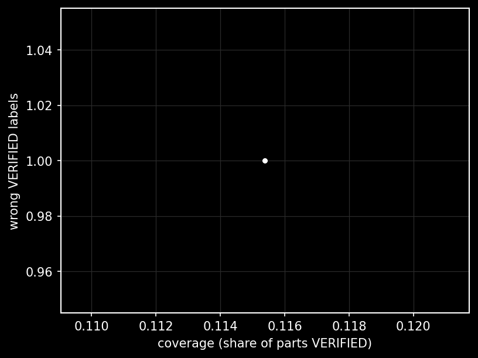
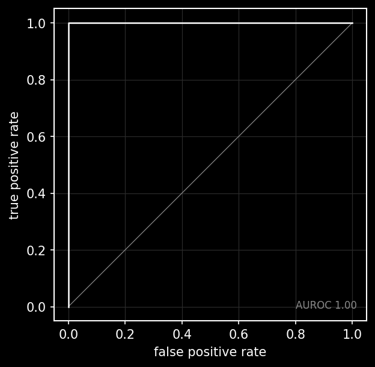

> **Not real results.** This report was generated from mock readers on a test label file to check that the evaluation harness works. No live models have been run yet.

# Salvage eval results — split: dev

26 labeled parts on 8 devices; labels `data/labels/parts.csv`; mock-reader seed 7; gate strictness swept over 1.00, 0.90, 0.80, 0.67.

## D1 — verify-or-abstain versus single-model confidence

| min agreement | coverage | wrong VERIFIED | wrong rate |
|---|---|---|---|
| 0.67 | 0.12 (3/26) | 1 | 0.33 |
| 0.80 | 0.12 (3/26) | 1 | 0.33 |
| 0.90 | 0.12 (3/26) | 1 | 0.33 |
| 1.00 | 0.12 (3/26) | 1 | 0.33 |

wrong VERIFIED parts at the 0.67 operating point: dev06-p03

Comparator: trusting one reader above a confidence cutoff (each column: coverage / wrong VERIFIED).

| cutoff | free-pool-contributor | muse-spark-1.3 | muse-spark-open |
|---|---|---|---|
| 1.00 | 0.00 | 0.00 | 0.00 |
| 0.90 | 0.15 | 0.12 | 0.19 |
| 0.80 | 0.38 / 2 | 0.38 / 2 | 0.42 / 1 |
| 0.67 | 0.69 / 3 | 0.58 / 2 | 0.58 / 1 |

## D2 — what predicts a wrong ID (AUROC)

| predictor | AUROC |
|---|---|
| disagreement | 1.00 |
| confidence:free-pool-contributor | 0.15 |
| confidence:muse-spark-1.3 | 0.00 |
| confidence:muse-spark-open | 0.00 |

Disagreement across readers beats every single reader's own confidence.

## D3 — one measurement resolves abstentions

21 parts were left NEEDS_MEASUREMENT or ABSTAIN; 8 of them reached VERIFIED once one meter reading was supplied — resolution rate **0.38**.

## Plots

